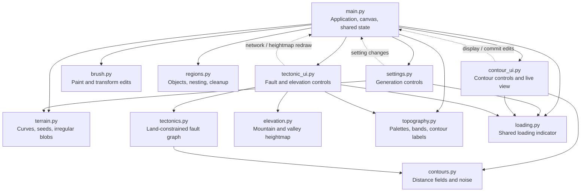

# Procedural RPG Map Generator

A Python desktop application for creating organic maps for tabletop role-playing campaigns. Built as a game jam / hackathon project, it combines procedural generation, manual painting, coastline editing, and artistic terrain generation.

The aim is to make maps that look natural and are enjoyable to customize. Geography and tectonics are used as creative inspiration, not as physically accurate simulations.

**Status: actively under development.** Features, controls, and generation methods may change.

## Main features

- Three starting map types: a large island, an inland sea, and archipelagos.
- A shared generator based on guiding curves, seed clusters, and smaller child blobs.
- Adjustable generation settings with visible construction geometry.
- Land and sea painting, object selection, deletion, and undo/redo.
- Noise-based coastline variation for individual objects, collections, or the whole map.
- Non-crossing fault networks constrained to land.
- Mountain and valley generation from additive elevation profiles.
- Colored topographic maps with contour lines, elevation labels, and selectable palettes.
- Zoom, panning, background calculations, and loading indicators.

## Run locally

The application uses **Python 3.10 or newer**, **Tkinter**, and **NumPy**. NumPy is the only external Python package required. Tkinter is included with many Python distributions; some installations require adding it separately.

From the project directory:

```sh
python -m pip install numpy
python main.py
```

The current interface is developed for Windows and opens maximized. Window handling and input bindings may need adaptation on other operating systems. This is a desktop application, not a browser application.

## How the map is built

The project uses two main layers:

1. **Land/sea map:** a grid defining which cells are land and which are water.
2. **Elevation map:** a separate grid of heights generated from the fault network.

Land and sea regions are extracted from the first layer as objects. The second layer adds terrain heights without moving the coastline.

The initial generator follows the same process for all three map types:

1. Create an open or closed guiding curve.
2. Place main seeds at approximately equal distances along that curve, with optional random offsets.
3. Give each seed children, then optionally give those children further descendants.
4. Reduce parent–child distances and blob sizes at each level.
5. Paint irregular blobs around the seeds. Each blob has its own orientation, elongation, and uneven outline.
6. Fill the interior for closed-curve maps. Invert the result for an inland sea.

The same seed and settings reproduce the same output within the current implementation. Changing the generator in a later version may change the result associated with a seed.

## 1. Layout

Choose the initial map type and image dimensions. The canvas also displays the curves and points used to construct the map.

| Attribute | Options / range | Effect |
| --- | --- | --- |
| Map type | Large island, inland sea, archipelagos | Selects a generation preset. Clicking a type creates a new random variation. |
| Aspect ratio | 1:1, 4:3, 3:2, 16:9, 21:9, and their portrait equivalents | Locks the relationship between width and height. |
| Maximum width / height | 1024–5120 cells; default 2048 | Sets the longer side exactly. The shorter side is rounded to the nearest whole cell. |
| Rotation | 90° clockwise or counterclockwise | Rotates the map and its construction geometry. |
| Seed | Displayed automatically | Identifies the random variation used for generation. |

### Map presets

| Preset | Construction |
| --- | --- |
| Large island | A closed curve with a filled interior and irregular blobs along its perimeter. |
| Inland sea | The same closed construction, with land and sea exchanged. |
| Archipelagos | An open curve organizing groups of islands. Root seeds organize clusters; their descendants paint the islands. |

Selecting a map type starts a new variation, clears manual edits, and restarts object numbering at 1. Generation settings are remembered separately for each type during the session.

### Construction overlay

- **Pink:** guiding curve.
- **Yellow:** main cluster seeds.
- **Cyan, orange, white:** successive child levels.
- **Dashed connections:** links from children to their parents.

This overlay is visible in Layout and Attributes. It represents the original generation structure, not a reconstruction of later brush edits.

## 2. Attributes

Customize the selected preset. Sliders update the generated map after a short pause while preserving the current seed. Hover over a slider or its label to adjust it with the mouse wheel. The reset button restores that preset's default settings.

### Curve and main seeds

| Attribute | Range | Effect |
| --- | --- | --- |
| Curve size | 0.4–1.2 | Scales the guiding curve around the image center. |
| Curve waviness | 0–1.5 | Controls how strongly the curve bends or deviates from a regular loop. |
| Minimum / maximum seeds | 3–16 each | Defines the range from which the main seed count is chosen. |
| Spacing variation | 0–0.45 | Adds random offsets as a fraction of the nominal spacing along the curve. Zero gives even spacing. |
| Open-curve end margin | 0–0.3 | Reserves a fraction of the curve length at each end before placing seeds. Available for archipelagos only. |

### Children and their positions

| Attribute | Range | Effect |
| --- | --- | --- |
| Child levels | 1–3 | Sets the depth of the seed hierarchy. The default is two levels. |
| Minimum / maximum children per parent | 1–5 each | Defines how many children each parent may produce. |
| Child angle variation | 0–180° | At 0°, children are evenly spaced around each parent with a random overall rotation. At 180°, directions are fully random. |
| Level 1 distance ratio | 0.05–0.9 | Multiplies the average distance between adjacent main seeds, measured along the curve. |
| Level 2 distance ratio | 0.05–0.9 | Multiplies the first-level parent–child distance. |
| Level 3 distance ratio | 0.05–0.9 | Multiplies the second-level distance. |

For example, if the average main-seed spacing is 100 cells, a first-level ratio of 0.3 gives a distance of 30 cells. A second-level ratio of 0.5 then gives a distance of 15 cells.

### Blob sizes

| Attribute | Range | Effect |
| --- | --- | --- |
| Root radius / seed spacing | 0.05–0.5 | Sets the nominal main-blob radius relative to average main-seed spacing. |
| Radius variation | 0–0.35 | Applies a random plus/minus fraction to nominal blob sizes. |
| Child radius / parent radius, per level | 0.1–0.7 | Scales each child's nominal radius relative to its parent's, before size variation. |

Minimum and maximum count settings stay ordered automatically. Controls for unused child levels are disabled. Size limits ensure that nominal child radii remain smaller than their parents even after random variation.

The radius is a size reference: the generated outline is irregular, so it is not a perfect circle with that exact radius.

## 3. Brush and objects

Paint land and sea directly onto the map. A circular cursor shows the brush footprint, and each completed stroke becomes one undoable action.

| Tool / attribute | Behavior |
| --- | --- |
| Land brush | Paints land with Ctrl+Q. |
| Sea brush | Paints water with Ctrl+A. |
| Brush size | Mouse wheel or Up/Down; diameter ranges from 4 to 300 display pixels. |
| Zoom | Ctrl+mouse wheel zooms around the pointer, from fitted view up to 32× that view. |
| Pan | Hold Space and drag with the left mouse button. |
| Fit image | Restores the centered, full-image view. |
| Object selection | Alt+left-click selects the region under the pointer; selecting a row in the object list also highlights it. |
| Deselect | Click the empty canvas outside the image. |
| Delete selected object | Changes its cells to the opposite terrain type: land becomes sea, or sea becomes land. |
| Clear brush edits | Restores generated terrain by clearing the stored edit layer, including applied contour edits. This action is undoable. |

Brush diameter is measured on screen. Zooming in therefore allows finer edits to the underlying map.

### Region objects

A region is an edge-connected area of land or sea. Pixels touching only at corners do not join two regions.

Each object stores:

- An ID and a land/sea type.
- Its area and bounding box.
- Ordered boundary contours.
- Neighboring objects.
- A parent and nesting level.

A typical nesting sequence is ocean → island → lake → island inside the lake. Regions touching the image border are roots at level 0.

After edits, objects are rebuilt to account for splitting, merging, and disappearance. IDs are matched by overlap where possible; new regions receive new IDs. Regions smaller than **5 map cells** are automatically filled with the opposite terrain type.

Selected objects appear in red. Holding Alt hides the brush circle and shows the normal pointer; releasing it restores the brush.

## 4. Contours

Add broad coastline variation or fine ruggedness to the current terrain.

Use **Apply to all objects**, or turn it off and **Alt+click** objects to toggle them into or out of a collection. The controls update the visible result automatically.

| Attribute | Range | Effect |
| --- | --- | --- |
| Displacement | 0–5% of the shorter image side | Controls how far a coastline can move. |
| Variation scale | 0.5–50% of the shorter side | Sets the size of the main noise features: small values create finer changes, large values create broader changes. |
| Detail levels | 1–6 | Adds progressively smaller noise layers. |
| Roughness | 0–1 | Controls how strongly the finer noise layers contribute. |
| Variation seed | 0–99999 | Changes the noise pattern while retaining the other settings. |

The algorithm combines smooth noise with an approximate signed-distance field around the coastline. A boundary shared by selected land and sea is processed only once.

Changes are calculated from committed terrain, not repeatedly applied to the previous slider result. **Apply** commits the result as one undoable action; **Cancel** discards it. Leaving the tab also discards an uncommitted result.

The outer image border stays fixed. Strong displacement can split or merge regions; object reconstruction handles the result after applying.

## 5. Tectonics and elevation

This tab contains two sections: **Network** and **Elevation**. It creates a stylized terrain layer from fault lines rather than simulating moving geological plates.

### Network

Interior junctions favor broader land areas away from the coast. Other points are placed on coastlines, including image edges where land reaches the frame. Nearby points are connected only when the entire segment stays on land and does not cross an existing fault.

Faults can meet at shared junctions. Lakes and separate landmasses prevent invalid connections. Requested point counts are targets: fewer points or faults may be generated when the land shape or spacing prevents placement.

| Attribute | Range | Effect |
| --- | --- | --- |
| Interior junctions | 2–60 | Requested number of interior points. |
| Coastline endpoints | 2–40 | Requested number of boundary points. |
| Minimum spacing | 1–15% of the shorter image side | Keeps points apart. |
| Network seed | 0–99999 | Changes point placement and the resulting fault network. |

Click a fault line to select its movement:

| Mode | Display | Elevation effect |
| --- | --- | --- |
| Convergence | Red, arrows pointing toward the fault | Adds mountain ridges and peaks. |
| Divergence | Blue, arrows pointing away from the fault | Subtracts elevation to form valleys. |
| Inactive | Gray, no movement arrows | Adds no elevation contribution. |

Yellow points are interior junctions; cyan points are coastline endpoints. Movement arrows are perpendicular to the selected fault's direction, and all faults display their own movement arrows. Zoom and pan apply to the network overlay too.

### Elevation

Peaks are distributed along faults. Gaussian-based profiles spread outward from them, while winding crests and multi-scale flank grooves reduce the appearance of smooth, isolated cones.

Mountain contributions add together; valley contributions subtract. The final land height is clamped at zero after combining all contributions. Water remains at zero, and the coastline does not change.

Heights are **artistic elevation units**, not calibrated real-world measurements.

| Attribute | Range | Effect |
| --- | --- | --- |
| Base land elevation | 0–2000 | Starting elevation before faults add or subtract height. |
| Maximum height per peak | 0–5000 | Upper amplitude for an individual mountain contribution. Overlap can produce higher total elevations. |
| Maximum depth per valley | 0–2000 | Upper amplitude of individual valley contributions. |
| Peaks per fault | 1–12 | Nominal number of peaks or depressions along a fault. |
| Peak count variation | 0–5 | Random plus/minus variation around that count; limited automatically so at least one remains. |
| Height variation | 0–1 | Randomly reduces individual amplitudes from their configured maximum. |
| Ridge width | 0.2–8% of the shorter image side | Controls how far a ridge or valley spreads across its fault. |
| Width variation | 0–0.75 | Random plus/minus fraction applied to profile widths. |
| Steepness | 1–4 | Changes the cross-fault profile. A value of 2 gives the underlying Gaussian profile; higher values produce steeper flanks. |
| Ridge ruggedness | 0–1 | Adds crest bends, irregular flank grooves, and smaller terrain variations. |
| Elevation seed | 0–99999 | Changes the elevation variation without regenerating fault placement. |

Elevation controls apply across the network; each fault retains its individually selected movement mode. Settings update the elevation layer automatically.

### Topographic display

| Display setting | Options / range | Effect |
| --- | --- | --- |
| Elevation palette | Terrain, Alpine, Sunset, Ocean tones, Grayscale | Colors each elevation band using the selected low-to-high gradient. |
| Contour interval | 25–1000 elevation units, in steps of 25 | Sets the height difference between contour levels. |
| Faults / arrows | On / off | Shows or hides the network overlay. |
| Elevation | On / off | Shows or hides the topographic layer. |

Every fifth contour is darker and may receive a spaced elevation label. Thin black outlines mark land/sea boundaries, lake shores, and the image frame. Palette and contour-interval changes only redraw the display; they do not recalculate the heightmap.

## Controls at a glance

| Input | Action |
| --- | --- |
| Ctrl+Q / Ctrl+A | Land / sea brush in tab 3 |
| Mouse wheel or Up/Down | Brush size in tab 3 |
| Alt+left-click | Select an object in tab 3; toggle collection membership in tab 4 |
| Click outside the image | Deselect the object in tab 3 |
| Ctrl+mouse wheel over the canvas | Zoom around the pointer |
| Hold Space + left-drag | Pan with the hand tool |
| Ctrl+Z / Ctrl+Y | Undo / redo terrain edits |
| Left Ctrl+F | Exchange land and sea between the island and inland-sea presets |
| Left-click a fault | Select it in tab 5 |
| Mouse wheel over a supported slider | Adjust that attribute |

## How the Python modules communicate

`main.py` owns the application, committed land map, editing history, canvas, and shared object state. Interface panels request calculations from their algorithm modules and return results through the application.

In this diagram, **solid arrows** show direct module dependencies and **dotted arrows** show callbacks or returned results going through the application. Python standard-library modules and NumPy are omitted for clarity.



### Module responsibilities

| File | Main responsibilities |
| --- | --- |
| `main.py` | Starts Tkinter, assembles tabs, manages map generation and region analysis, draws the canvas, handles zoom/pan and shortcuts, and stores edit history. |
| `settings.py` | Builds the generation sliders, keeps linked ranges consistent, and converts controls into a `MapPreset`. |
| `terrain.py` | Defines presets, creates guiding curves and seed hierarchies, paints irregular blobs, and rotates masks and geometry. |
| `brush.py` | Applies circular brush stamps and stored region edits; transforms saved edits for rotation or land/sea inversion. |
| `regions.py` | Finds connected land and sea components, matches IDs, traces boundaries, assigns nesting relationships, and removes tiny regions. |
| `contour_ui.py` | Manages target selection, live contour calculations, cancellation, and committing changes to editing history. |
| `contours.py` | Computes approximate boundary distances and uses multi-scale noise to displace selected coastlines. Its distance helper is also used for fault placement. |
| `tectonic_ui.py` | Builds and displays fault networks, manages line selection and movement modes, runs elevation calculations, and exposes display controls. |
| `tectonics.py` | Places interior/coastal nodes, checks land coverage and segment intersections, and builds the fault graph. |
| `elevation.py` | Generates the additive mountain/valley heightmap with peak variation, width, steepness, and ruggedness. |
| `topography.py` | Converts sampled heights into palette-colored bands, contour lines, and elevation labels. |
| `loading.py` | Provides the consistent loading strip used at the top of tabs 2–5. |

### Data flow

1. Attribute controls supply a preset to the terrain generator.
2. Generation returns a Boolean land mask and its construction geometry.
3. Brush and applied contour edits modify the land mask.
4. Region analysis rebuilds objects from that edited mask.
5. The tectonics panel uses the current mask and region labels to generate faults.
6. Fault modes and elevation settings produce a separate heightmap.
7. The canvas combines map colors, topographic bands, outlines, and optional overlays.

Background workers handle map generation, region reconstruction, contour variation, fault placement, and elevation calculations. The Tkinter thread updates the interface when current results are ready. Obsolete results are discarded when newer changes supersede them.

## Editing behavior and current limitations

- **Loading indicators:** tabs 2–5 show a basic animated bar during queued or running calculations. It indicates activity, not a percentage of completion.
- **Undo scope:** painting, object deletion, clearing edits, and applied contour changes are undoable. Generation settings and tectonic settings are not part of that history.
- **Regeneration:** generation-setting changes reset undo history. Saved terrain edits are replayed over the new generated map; they are not object-level geometric transformations.
- **Network invalidation:** changing the land/sea map invalidates the fault network and elevation layer. Regenerating a network also replaces its per-fault movement choices.
- **Resolution:** larger grids and more complex settings require more time and memory. Display zoom does not increase the underlying map resolution.
- **Terrain realism:** elevation is procedural artwork, without hydraulic erosion, drainage simulation, or a physical plate model.
- **Persistence:** there is currently no built-in project save/load or map export feature. Work is held in the running application.

Possible future additions include rivers, settlements, roads, and other features useful for RPG campaigns.
